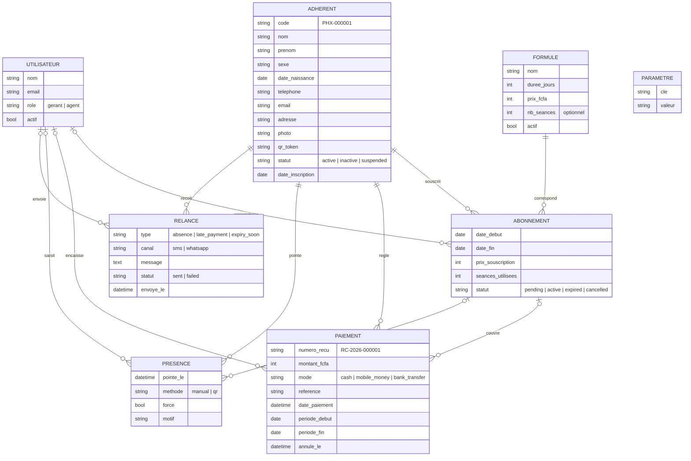

# 03 - Modèle conceptuel de données (MCD)

## 1. Entités

| Entité | Description |
|---|---|
| UTILISATEUR | Compte de connexion : gérant ou agent d'accueil |
| ADHERENT | Personne inscrite à la salle |
| FORMULE | Type d'abonnement du catalogue (mensuel, trimestriel, 10 séances...) |
| ABONNEMENT | Souscription d'une formule par un adhérent sur une période |
| PAIEMENT | Règlement encaissé, avec reçu |
| PRESENCE | Pointage d'un adhérent à une date et heure |
| RELANCE | Message SMS / WhatsApp envoyé à un adhérent |
| PARAMETRE | Valeur de configuration (tolérance, seuils, infos du club) |

## 2. Associations

| Association | Entités | Cardinalités | Lecture |
|---|---|---|---|
| souscrire | ADHERENT - ABONNEMENT | 1,n - 1,1 | Un adhérent souscrit 0 ou n abonnements ; un abonnement concerne un seul adhérent |
| correspondre | FORMULE - ABONNEMENT | 0,n - 1,1 | Une formule sert à 0 ou n abonnements ; un abonnement a une seule formule |
| régler | ADHERENT - PAIEMENT | 0,n - 1,1 | Un adhérent effectue 0 ou n paiements |
| couvrir | ABONNEMENT - PAIEMENT | 0,n - 0,1 | Un abonnement est couvert par 0 ou n paiements ; un paiement couvre au plus un abonnement |
| pointer | ADHERENT - PRESENCE | 0,n - 1,1 | Un adhérent a 0 ou n présences |
| utiliser | ABONNEMENT - PRESENCE | 0,n - 0,1 | Une présence consomme au plus un abonnement |
| relancer | ADHERENT - RELANCE | 0,n - 1,1 | Un adhérent reçoit 0 ou n relances |
| enregistrer | UTILISATEUR - ABONNEMENT / PAIEMENT / PRESENCE / RELANCE | 0,n - 0,1 | L'utilisateur qui a saisi l'opération |

## 3. Diagramme

## 4. Choix de modélisation

- Le retard de paiement et l'absence ne sont pas des entités : ce sont des états calculés à partir d'ABONNEMENT, PAIEMENT et PRESENCE (voir règles RG-RET et RG-ABS). Seules les RELANCES sont persistées.
- Le prix est recopié dans ABONNEMENT au moment de la souscription pour que l'historique reste exact si le tarif change.
- PAIEMENT porte sa propre période couverte, ce qui permet les paiements hors abonnement (frais d'inscription, produits) et les acomptes.
- Le statut de l'adhérent est dérivé de ses abonnements, mais stocké pour permettre les filtres rapides et la suspension manuelle. Il est recalculé par la tâche quotidienne et à chaque souscription / paiement.
- PARAMETRE est une table clé / valeur simple, suffisante pour une dizaine de réglages.
