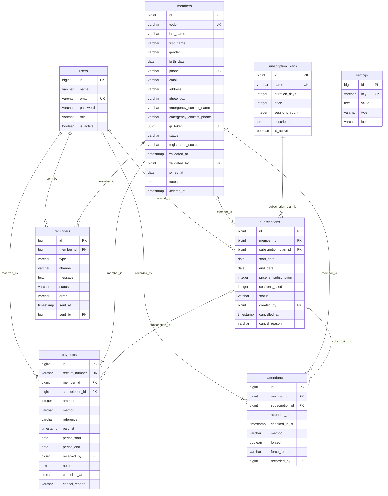

# 04 - Modèle logique (MLD) et dictionnaire de données

SGBD : PostgreSQL 15+. Toutes les tables ont `id bigserial`, `created_at`, `updated_at`. Les montants sont en `integer` (FCFA, sans décimales). Les dates calendaires sont en `date`, les horodatages en `timestamp`.

## 1. Schéma relationnel



## 2. Dictionnaire de données

### users

| Colonne | Type | Null | Contrainte | Description |
|---|---|---|---|---|
| id | bigint | non | PK | |
| name | varchar(100) | non | | Nom affiché |
| email | varchar(150) | non | unique | Identifiant de connexion |
| password | varchar(255) | non | | Haché (bcrypt) |
| role | varchar(20) | non | check in (manager, agent) | manager = gérant, agent = accueil |
| is_active | boolean | non | défaut true | Compte désactivable |
| remember_token | varchar(100) | oui | | Laravel |
| email_verified_at | timestamp | oui | | Laravel |

### members

| Colonne | Type | Null | Contrainte | Description |
|---|---|---|---|---|
| id | bigint | non | PK | |
| code | varchar(20) | non | unique | `PHX-000001`, généré |
| last_name | varchar(100) | non | | Nom |
| first_name | varchar(100) | non | | Prénom |
| gender | varchar(1) | oui | check in (M, F) | |
| birth_date | date | oui | | |
| phone | varchar(20) | non | unique | Format `06 XXX XX XX` ou `+242...` |
| email | varchar(150) | oui | | |
| address | varchar(255) | oui | | Quartier / arrondissement |
| photo_path | varchar(255) | oui | | Chemin storage |
| emergency_contact_name | varchar(100) | oui | | Personne à contacter |
| emergency_contact_phone | varchar(20) | oui | | |
| qr_token | uuid | non | unique | Contenu du QR code |
| status | varchar(20) | non | check in (pending, active, inactive, suspended), défaut pending | RG-ADH-03, 05 |
| registration_source | varchar(10) | non | check in (on_site, online), défaut on_site | Canal d'inscription RG-ADH-05 |
| validated_at | timestamp | oui | | Date de validation de l'adhésion RG-ADH-06 |
| validated_by | bigint | oui | FK users, set null | Agent ou gérant ayant validé (ou encaissé) |
| joined_at | date | non | | Date d'inscription |
| notes | text | oui | | Remarques internes |
| deleted_at | timestamp | oui | | Soft delete |

Index : `(last_name, first_name)`, `status`.

### subscription_plans

| Colonne | Type | Null | Contrainte | Description |
|---|---|---|---|---|
| id | bigint | non | PK | |
| name | varchar(100) | non | unique | Ex : Mensuel, Trimestriel, Carte 10 séances |
| duration_days | integer | non | > 0 | Durée de validité |
| price | integer | non | >= 0 | Prix en FCFA |
| sessions_count | integer | oui | > 0 | Nombre de séances si formule limitée, null = illimité |
| registration_fee | integer | oui | >= 0 | Frais d'inscription spécifiques, null = paramètre global |
| description | text | oui | | |
| is_active | boolean | non | défaut true | Formule proposable à la souscription |
| sort_order | integer | non | défaut 0 | Ordre d'affichage |

### subscriptions

| Colonne | Type | Null | Contrainte | Description |
|---|---|---|---|---|
| id | bigint | non | PK | |
| member_id | bigint | non | FK members, cascade | |
| subscription_plan_id | bigint | non | FK subscription_plans, restrict | |
| start_date | date | non | | |
| end_date | date | non | >= start_date | RG-ABO-01 |
| price_at_subscription | integer | non | | Prix figé RG-ABO-02 |
| sessions_used | integer | non | défaut 0 | Compteur pour formules à séances |
| status | varchar(20) | non | check in (pending, active, expired, cancelled) | RG-ABO-05 |
| created_by | bigint | oui | FK users, set null | Agent ayant saisi |
| cancelled_at | timestamp | oui | | |
| cancel_reason | varchar(255) | oui | | |

Index : `(member_id, status)`, `end_date`.
Colonnes calculées en requête : `amount_paid`, `balance_due`.

### payments

| Colonne | Type | Null | Contrainte | Description |
|---|---|---|---|---|
| id | bigint | non | PK | |
| receipt_number | varchar(20) | non | unique | `RC-2026-000001` RG-PAI-03 |
| member_id | bigint | non | FK members, restrict | |
| subscription_id | bigint | oui | FK subscriptions, set null | Null si paiement hors abonnement |
| type | varchar(20) | non | check in (registration, subscription, other), défaut subscription | RG-PAI-08 |
| amount | integer | non | > 0 | FCFA |
| method | varchar(20) | non | check in (cash, mobile_money, bank_transfer) | |
| reference | varchar(100) | oui | | Référence MoMo / virement |
| paid_at | timestamp | non | | Date et heure d'encaissement |
| period_start | date | oui | | Période couverte |
| period_end | date | oui | | |
| received_by | bigint | oui | FK users, set null | Agent |
| notes | text | oui | | |
| cancelled_at | timestamp | oui | | RG-PAI-07 |
| cancel_reason | varchar(255) | oui | | |

Index : `paid_at`, `(member_id, paid_at)`.

### attendances

| Colonne | Type | Null | Contrainte | Description |
|---|---|---|---|---|
| id | bigint | non | PK | |
| member_id | bigint | non | FK members, cascade | |
| subscription_id | bigint | oui | FK subscriptions, set null | Abonnement utilisé |
| attended_on | date | non | unique avec member_id | Jour calendaire RG-PTG-03 |
| checked_in_at | timestamp | non | | Heure exacte |
| method | varchar(10) | non | check in (manual, qr) | |
| forced | boolean | non | défaut false | RG-PTG-06 |
| force_reason | varchar(255) | oui | | |
| recorded_by | bigint | oui | FK users, set null | |

Index : `attended_on`, unique `(member_id, attended_on)`.

### reminders

| Colonne | Type | Null | Contrainte | Description |
|---|---|---|---|---|
| id | bigint | non | PK | |
| member_id | bigint | non | FK members, cascade | |
| type | varchar(20) | non | check in (absence, late_payment, expiry_soon) | |
| channel | varchar(10) | non | check in (sms, whatsapp) | |
| message | text | non | | Texte envoyé |
| status | varchar(10) | non | check in (sent, failed), défaut sent | |
| error | varchar(255) | oui | | Erreur fournisseur |
| sent_at | timestamp | non | | |
| sent_by | bigint | oui | FK users, set null | |

Index : `(member_id, type, sent_at)` pour RG-REL-04.

### expense_categories

| Colonne | Type | Null | Contrainte | Description |
|---|---|---|---|---|
| id | bigint | non | PK | |
| name | varchar(100) | non | unique | Loyer, Salaires, Électricité... |
| is_active | boolean | non | défaut true | |
| sort_order | integer | non | défaut 0 | |

### expenses

| Colonne | Type | Null | Contrainte | Description |
|---|---|---|---|---|
| id | bigint | non | PK | |
| expense_category_id | bigint | non | FK expense_categories, restrict | |
| label | varchar(150) | non | | Libellé |
| amount | integer | non | > 0 | FCFA |
| method | varchar(20) | non | check in (cash, mobile_money, bank_transfer) | |
| payee | varchar(150) | oui | | Bénéficiaire |
| reference | varchar(100) | oui | | N° facture, transaction |
| spent_on | date | non | | |
| receipt_path | varchar(255) | oui | | Justificatif |
| notes | text | oui | | |
| recorded_by | bigint | oui | FK users, set null | |
| cancelled_at | timestamp | oui | | RG-CAI-02 |
| cancel_reason | varchar(255) | oui | | |

Index : `spent_on`.

### training_programs

| Colonne | Type | Null | Contrainte | Description |
|---|---|---|---|---|
| id | bigint | non | PK | |
| member_id | bigint | non | FK members, cascade | |
| kind | varchar(20) | non | check in (training, nutrition) | |
| title | varchar(150) | non | | |
| status | varchar(20) | non | check in (proposed, approved, declined, imposed, archived) | RG-PRG-03 |
| proposed_by_member | boolean | non | défaut false | Phase 2 |
| author_id | bigint | oui | FK users, set null | Coach ou gérant auteur |
| starts_on, ends_on | date | oui | | Période |
| content | jsonb | non | défaut {} | Jours, séances, exercices ou repas |
| notes | text | oui | | |
| reviewed_by | bigint | oui | FK users, set null | |
| reviewed_at | timestamp | oui | | |
| review_note | varchar(255) | oui | | Motif de refus ou commentaire |

Index : `(member_id, status)`.

### settings

| Colonne | Type | Null | Contrainte | Description |
|---|---|---|---|---|
| id | bigint | non | PK | |
| key | varchar(50) | non | unique | Ex : checkin_tolerance_days |
| value | text | oui | | Stockée en texte, castée selon `type` |
| type | varchar(10) | non | check in (int, string, bool) | |
| label | varchar(100) | non | | Libellé affiché dans l'écran de paramétrage |

### Tables Laravel standard

`personal_access_tokens` (Sanctum), `password_reset_tokens`, `sessions`, `cache`, `jobs`, `failed_jobs`. Fournies par Laravel 11.

## 3. Vues et requêtes clés

Retards de paiement (RG-RET-01), une CTE par adhérent sur son dernier abonnement non annulé :

```sql
WITH last_sub AS (
  SELECT DISTINCT ON (s.member_id) s.*
  FROM subscriptions s
  WHERE s.status <> 'cancelled'
  ORDER BY s.member_id, s.end_date DESC
),
paid AS (
  SELECT subscription_id, COALESCE(SUM(amount), 0) AS amount_paid
  FROM payments WHERE cancelled_at IS NULL GROUP BY subscription_id
)
SELECT m.id, m.code, m.last_name, m.first_name, m.phone,
       ls.end_date,
       CURRENT_DATE - ls.end_date - :late_days AS days_late,
       CASE WHEN ls.price_at_subscription - COALESCE(p.amount_paid, 0) > 0
            THEN ls.price_at_subscription - COALESCE(p.amount_paid, 0)
            ELSE ls.price_at_subscription END AS amount_due
FROM members m
JOIN last_sub ls ON ls.member_id = m.id
LEFT JOIN paid p ON p.subscription_id = ls.id
WHERE m.deleted_at IS NULL
  AND m.status NOT IN ('suspended', 'pending')
  AND ls.end_date + :late_days < CURRENT_DATE
  AND NOT EXISTS (
    SELECT 1 FROM subscriptions s2
    WHERE s2.member_id = m.id AND s2.status IN ('active', 'pending')
  );
```

Absences (RG-ABS-01) :

```sql
SELECT m.id, m.code, m.last_name, m.first_name, m.phone,
       MAX(a.attended_on) AS last_attendance
FROM members m
LEFT JOIN attendances a ON a.member_id = m.id
WHERE m.status = 'active' AND m.deleted_at IS NULL
GROUP BY m.id
HAVING COALESCE(MAX(a.attended_on), CURRENT_DATE - :inactivity_days - 1)
       < CURRENT_DATE - :inactivity_days;
```
