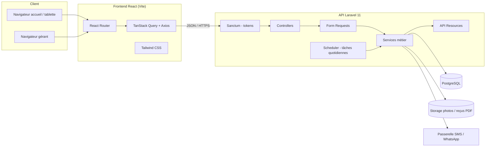

# 05 - Architecture technique

## 1. Vue d'ensemble



## 2. Backend Laravel

Architecture par couche : Controller - Form Request - Service - Model - Resource.

```
app/
  Enums/
    MemberStatus.php
    SubscriptionStatus.php
    PaymentMethod.php
    AttendanceMethod.php
    ReminderType.php
    ReminderChannel.php
    UserRole.php
  Http/
    Controllers/Api/
      AuthController.php
      MemberController.php
      SubscriptionPlanController.php
      SubscriptionController.php
      AttendanceController.php
      PaymentController.php
      LatePaymentController.php
      AbsenceController.php
      ReminderController.php
      DashboardController.php
      SettingController.php
      UserController.php
    Requests/
      Member/StoreMemberRequest.php
      Member/UpdateMemberRequest.php
      Subscription/StoreSubscriptionRequest.php
      Attendance/StoreAttendanceRequest.php
      Payment/StorePaymentRequest.php
      ...
    Resources/
      MemberResource.php, SubscriptionResource.php, PaymentResource.php, ...
    Middleware/
      EnsureRole.php
  Models/
    User.php, Member.php, SubscriptionPlan.php, Subscription.php,
    Payment.php, Attendance.php, Reminder.php, Setting.php
  Services/
    MemberService.php
    SubscriptionService.php
    AttendanceService.php
    PaymentService.php
    LatePaymentService.php
    AbsenceService.php
    ReminderService.php
    DashboardService.php
    ReceiptNumberService.php
  Console/Commands/
    RefreshSubscriptionStatuses.php
database/
  migrations/
  seeders/
routes/
  api.php
```

Points clés :
- Sanctum en mode token (SPA sur un autre domaine possible) ; le frontend stocke le token et l'envoie en `Authorization: Bearer`.
- Middleware `role:manager` sur les routes de paramétrage, statistiques et annulations.
- Les règles métier vivent dans `Services/`, jamais dans les controllers.
- Les montants sont renvoyés en entier, le frontend formate `12 500 FCFA`.
- Les dates sont renvoyées en ISO (`2026-11-01`), le frontend affiche `01/11/2026` (`dayjs` ou `Intl.DateTimeFormat('fr-FR')`).
- Tâche planifiée `subscriptions:refresh-status` chaque nuit à 00:05 (cron `* * * * * php artisan schedule:run`).

## 3. Frontend React

```
src/
  api/
    client.js            (instance Axios, intercepteur token, baseURL)
    members.js, subscriptions.js, attendances.js, payments.js, ...
  hooks/
    useMembers.js, useMember.js, useCheckIn.js, usePayments.js, ...
  components/
    ui/        (Button, Input, Select, Modal, Table, Badge, Pagination)
    layout/    (Sidebar, Topbar, AppLayout)
    members/   (MemberForm, MemberCard, MemberSearch)
    attendance/(CheckInPanel, QrScanner, TodayAttendanceList)
    payments/  (PaymentForm, ReceiptPreview)
  pages/
    LoginPage.jsx
    DashboardPage.jsx
    MembersPage.jsx, MemberDetailPage.jsx, MemberCreatePage.jsx
    CheckInPage.jsx
    PaymentsPage.jsx
    LatePaymentsPage.jsx
    AbsencesPage.jsx
    SettingsPage.jsx (plans, règles, utilisateurs)
  router.jsx
  utils/
    format.js   (formatFcfa, formatDate)
  main.jsx
```

- TanStack Query : une clé par ressource (`['members', filters]`, `['member', id]`), invalidation après mutation.
- Routes protégées par un composant `RequireAuth`, routes gérant par `RequireRole('manager')`.
- Scan QR : `html5-qrcode` sur la page pointage (caméra tablette).

## 4. Hébergement

| Option | Détail |
|---|---|
| o2switch (mutualisé) | API Laravel via Phusion Passenger (`public/` comme racine), PostgreSQL disponible sur o2switch, frontend buildé servi en statique sur un sous-domaine (`app.phenixclub.cg`), API sur `api.phenixclub.cg`, cron o2switch pour `schedule:run` |
| VPS Hetzner | Nginx + PHP-FPM 8.3 + PostgreSQL 16, Supervisor pour les queues, Certbot pour le TLS, sauvegarde `pg_dump` quotidienne vers Hetzner Storage Box |

Variables d'environnement sensibles : `DB_*`, `SANCTUM_STATEFUL_DOMAINS`, `FRONTEND_URL` (CORS), clés passerelle SMS.

## 5. Sécurité

- Mots de passe bcrypt, tokens Sanctum avec expiration (`expiration => 60*24*7`)
- CORS restreint au domaine du frontend
- Validation systématique par Form Request
- Rate limiting sur `/login`
- Aucune suppression physique des données financières
- Journalisation des actions sensibles (annulation de paiement, pointage forcé) via `created_by` / `cancelled_at`
