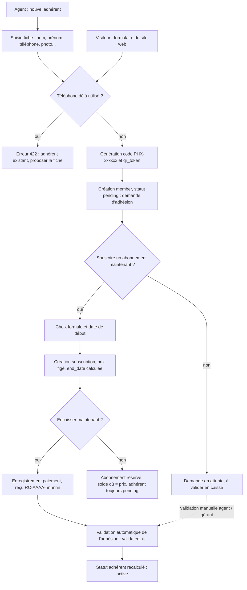
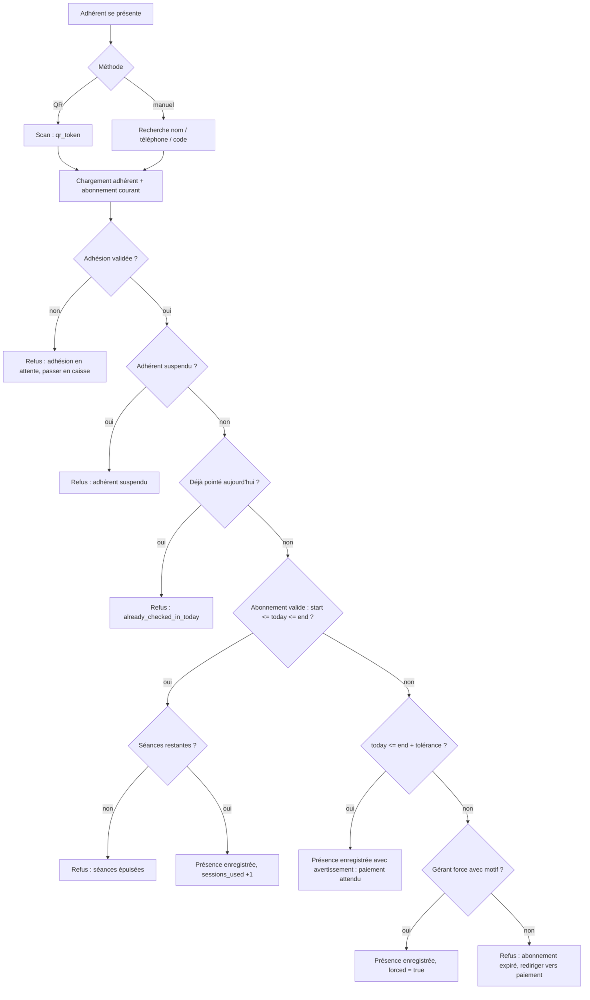
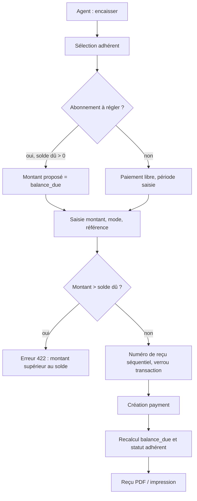
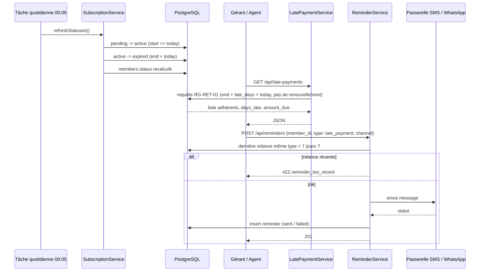
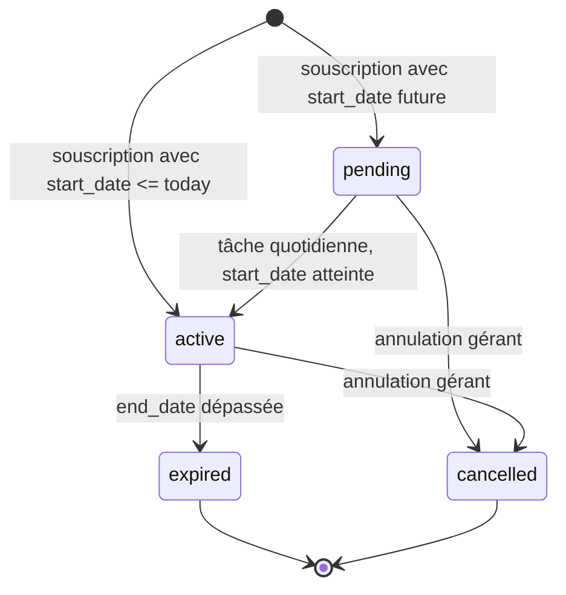
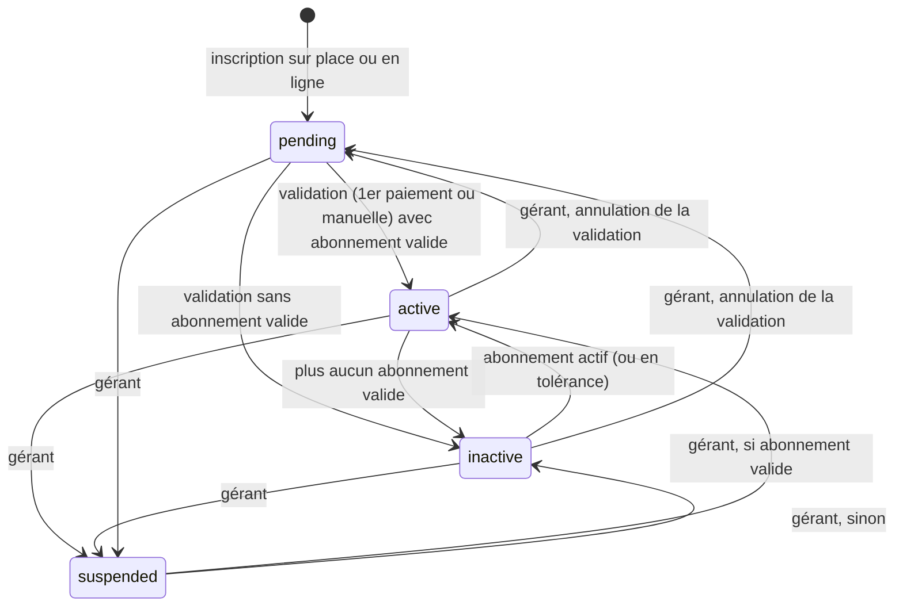

# 06 - Flux métier

## 1. Inscription d'un adhérent

Règle appliquée : RG-ADH-05 et RG-ADH-06. Le visiteur du site web et la personne à l'accueil suivent le même circuit, seule la source diffère.

## 2. Pointage à l'arrivée

Règle appliquée : RG-PTG-01 à RG-PTG-06.

## 3. Encaissement d'un paiement

Règle appliquée : RG-PAI-01 à RG-PAI-07.

## 4. Détection des retards et rappel

## 5. Cycle de vie d'un abonnement

Fenêtres associées à un abonnement `expired` :
- `end_date < today <= end_date + checkin_tolerance_days` : pointage accepté avec avertissement
- `today > end_date + late_payment_days` : adhérent en retard de paiement (si pas de renouvellement)

## 6. Statut de l'adhérent

`active` et `inactive` sont recalculés chaque nuit et à chaque souscription / paiement ; `pending` et `suspended` sont des statuts manuels, jamais recalculés.
