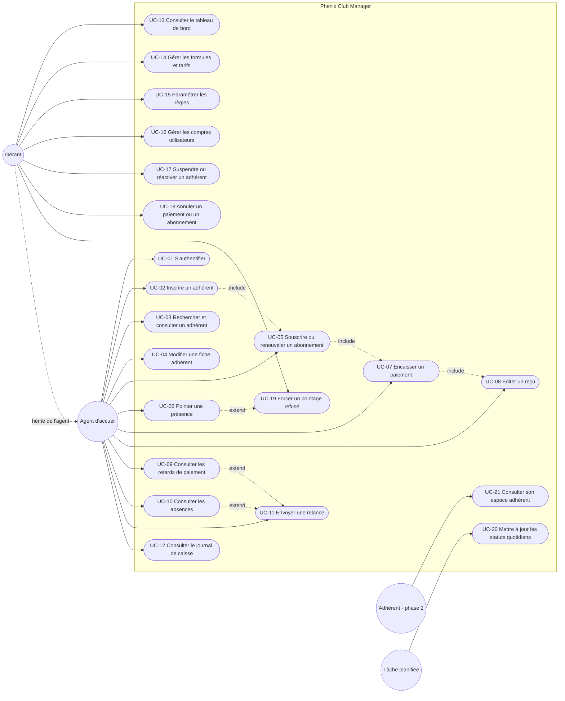

# 09 - Cas d'utilisation

Complément des user stories (doc 07) : ici chaque cas décrit le dialogue complet entre l'acteur et le système, avec les scénarios alternatifs et les règles appliquées (doc 02).

## 1. Diagramme des cas d'utilisation

Mermaid n'a pas de notation UML "use case" native, le diagramme est représenté sous forme de graphe : acteurs à gauche, cas d'utilisation au centre, système à droite.

Lecture : le gérant hérite de tous les cas de l'agent et dispose en plus des cas de pilotage et d'exception. `include` = étape obligatoire, `extend` = extension optionnelle.

## 2. Récapitulatif

| ID | Cas d'utilisation | Acteur principal | Priorité | Règles |
|---|---|---|---|---|
| UC-01 | S'authentifier | Agent, Gérant | P1 | |
| UC-02 | Inscrire un adhérent | Agent | P1 | RG-ADH-01, 02, 03 |
| UC-03 | Rechercher et consulter un adhérent | Agent | P1 | |
| UC-04 | Modifier une fiche adhérent | Agent | P1 | RG-ADH-02 |
| UC-05 | Souscrire ou renouveler un abonnement | Agent | P1 | RG-ABO-01 à 06 |
| UC-06 | Pointer une présence | Agent | P1 | RG-PTG-01 à 05 |
| UC-07 | Encaisser un paiement | Agent | P1 | RG-PAI-01 à 06 |
| UC-08 | Éditer un reçu | Agent | P1 | RG-PAI-03 |
| UC-09 | Consulter les retards de paiement | Agent, Gérant | P1 | RG-RET-01 à 05 |
| UC-10 | Consulter les absences | Agent, Gérant | P2 | RG-ABS-01, 02 |
| UC-11 | Envoyer une relance | Agent | P2 | RG-REL-01 à 04 |
| UC-12 | Consulter le journal de caisse | Agent, Gérant | P1 | |
| UC-13 | Consulter le tableau de bord | Gérant | P2 | section 9 des règles |
| UC-14 | Gérer les formules et tarifs | Gérant | P1 | RG-ABO-02 |
| UC-15 | Paramétrer les règles | Gérant | P1 | paramètres (P) |
| UC-16 | Gérer les comptes utilisateurs | Gérant | P2 | |
| UC-17 | Suspendre ou réactiver un adhérent | Gérant | P2 | RG-ADH-03 |
| UC-18 | Annuler un paiement ou un abonnement | Gérant | P2 | RG-PAI-07, RG-ABO-05 |
| UC-19 | Forcer un pointage refusé | Gérant | P2 | RG-PTG-06 |
| UC-20 | Mettre à jour les statuts quotidiens | Tâche planifiée | P1 | RG-ABO-07, RG-ADH-03 |
| UC-21 | Consulter son espace adhérent | Adhérent | P3 | phase 2 |
| UC-22 | Saisir une dépense | Agent, Gérant | P1 | RG-CAI-01, 02 |
| UC-23 | Consulter la caisse et les manquants | Gérant | P1 | RG-CAI-03, 04 |
| UC-24 | Créer ou imposer un programme | Coach, Gérant | P2 | RG-PRG-01 à 05 |
| UC-25 | Valider ou refuser un programme proposé | Coach, Gérant | P2 | RG-PRG-03, 04 |
| UC-26 | Proposer son programme ou ses jours | Adhérent | P3 | RG-PRG-02 (phase 2) |

## 3. Fiches détaillées

### UC-01 S'authentifier

| | |
|---|---|
| Acteur | Agent, Gérant |
| Préconditions | Compte existant et actif |
| Déclencheur | L'utilisateur ouvre l'application |
| Postconditions | Token Sanctum émis, rôle connu du frontend |

Scénario nominal :
1. L'utilisateur saisit email et mot de passe.
2. Le système vérifie les identifiants et que `is_active` est vrai.
3. Le système renvoie un token et le profil (nom, rôle).
4. Le frontend affiche l'écran d'accueil adapté au rôle (pointage pour l'agent, tableau de bord pour le gérant).

Alternatives :
- 2a. Identifiants invalides : message "Email ou mot de passe incorrect", compteur de tentatives (5 par minute).
- 2b. Compte désactivé : message "Compte désactivé, contactez le gérant".

### UC-02 Inscrire un adhérent

| | |
|---|---|
| Acteur | Agent |
| Préconditions | Authentifié |
| Déclencheur | Une personne souhaite s'inscrire |
| Postconditions | Demande d'adhésion créée (statut `pending`) avec code et QR token, source `on_site` |
| Inclut | UC-05 (optionnel dans la foulée) |
| Variante | UC-02b inscription en ligne : même fiche, source `online`, sans agent |

Scénario nominal :
1. L'agent ouvre "Nouvel adhérent".
2. Il saisit nom, prénom, téléphone (obligatoires), sexe, date de naissance, adresse, email, contact d'urgence, photo (optionnels).
3. Le système vérifie l'unicité du téléphone (RG-ADH-02).
4. Le système génère le code `PHX-000001` et le QR token (RG-ADH-01), enregistre la fiche au statut `pending` (RG-ADH-05).
5. Le système propose de souscrire un abonnement immédiatement (UC-05) puis d'encaisser (UC-07) ; l'encaissement valide automatiquement l'adhésion (RG-ADH-06).
6. Si la personne ne paie pas tout de suite, la demande reste en attente ; l'agent ou le gérant pourra la valider manuellement plus tard (bouton "Valider l'adhésion").
7. Une fois validée, l'agent imprime la carte avec QR code.

Alternatives :
- 3a. Téléphone déjà utilisé : le système affiche la fiche existante et propose de l'ouvrir plutôt que de créer un doublon.
- 2a. Photo absente : la fiche est créée avec un avatar par défaut.

### UC-02b Demander son adhésion en ligne (site web)

| | |
|---|---|
| Acteur | Visiteur du site web |
| Préconditions | Paramètre `online_registration_enabled` activé par le gérant |
| Postconditions | Demande `pending`, source `online`, visible dans la liste "Demandes en attente" de l'accueil |

Scénario nominal :
1. Le visiteur remplit le formulaire (nom, prénom, téléphone, formule souhaitée en option).
2. Le système vérifie le paramètre, l'unicité du téléphone et le pot de miel anti-bot (RG-ADH-07).
3. Le système crée la fiche `pending` et renvoie uniquement un message de confirmation et le code adhérent.
4. À son premier passage au club, l'agent retrouve la fiche par téléphone ou code, fait souscrire et encaisse : l'adhésion est validée.

Alternatives :
- 2a. Inscriptions en ligne fermées : message "Rendez-vous à l'accueil du club".
- 2b. Téléphone déjà enregistré : message invitant à passer à l'accueil (pas d'information sur la fiche existante).

### UC-03 Rechercher et consulter un adhérent

| | |
|---|---|
| Acteur | Agent, Gérant |
| Préconditions | Authentifié |
| Postconditions | Aucune modification |

Scénario nominal :
1. L'agent tape un nom, un téléphone ou un code dans la barre de recherche (ou scanne le QR).
2. Le système affiche les résultats en temps réel (recherche insensible à la casse, nom ou prénom dans n'importe quel ordre).
3. L'agent ouvre la fiche : identité, statut, abonnement courant avec date de fin et solde dû, dernière présence, historiques (abonnements, paiements, présences, relances).
4. Depuis la fiche, l'agent peut lancer UC-04, UC-05, UC-06, UC-07, UC-11.

Alternatives :
- 2a. Aucun résultat : proposer "Inscrire un nouvel adhérent" avec le terme saisi prérempli.
- 1a. QR invalide ou inconnu : message "QR code non reconnu".

### UC-04 Modifier une fiche adhérent

Scénario nominal : l'agent ouvre la fiche, modifie les champs, le système revalide l'unicité du téléphone et enregistre. Le code, le QR token et la date d'inscription ne sont pas modifiables.

Alternatives : téléphone déjà pris par un autre adhérent (422).

### UC-05 Souscrire ou renouveler un abonnement

| | |
|---|---|
| Acteur | Agent |
| Préconditions | Adhérent existant, non suspendu ; au moins une formule active |
| Postconditions | Abonnement créé, prix figé, statut adhérent recalculé |
| Inclut | UC-07 (encaissement, optionnel immédiat) |

Scénario nominal :
1. L'agent choisit une formule dans le catalogue actif.
2. Le système propose la date de début : lendemain de la fin de l'abonnement courant s'il en existe un valide, sinon aujourd'hui (RG-ABO-03). L'agent peut la modifier.
3. Le système calcule `end_date = start_date + duration_days - 1` (RG-ABO-01) et affiche le récapitulatif : période, prix.
4. L'agent confirme. Le système crée l'abonnement avec `price_at_subscription` figé (RG-ABO-02), au statut `active` si la date de début est aujourd'hui ou passée, `pending` sinon (RG-ABO-04).
5. Le système propose d'encaisser (UC-07) avec le montant total prérempli.
6. Le statut de l'adhérent passe à `active` si l'abonnement est actif (RG-ADH-03).

Alternatives :
- 1a. Adhérent suspendu : refus, "Adhérent suspendu, voir le gérant".
- 2a. Date de début antérieure à aujourd'hui : autorisée (régularisation) avec avertissement.
- 4a. Un abonnement `pending` existe déjà : le nouveau est refusé tant que l'existant n'est pas annulé (évite les chevauchements).
- 5a. L'adhérent ne paie pas tout de suite : abonnement créé avec `balance_due = prix`, il apparaîtra en retard après `late_payment_days` (RG-RET-01 cas 2).

### UC-06 Pointer une présence

| | |
|---|---|
| Acteur | Agent |
| Préconditions | Authentifié ; adhérent identifié (scan ou recherche) |
| Postconditions | Présence enregistrée, compteur de séances incrémenté si formule à séances |
| Étendu par | UC-19 |

Scénario nominal :
1. L'adhérent présente son QR code ou donne son nom.
2. Le système charge l'adhérent et son abonnement courant.
3. Le système vérifie dans l'ordre : adhésion validée (non `pending`) ; adhérent non suspendu ; pas déjà pointé aujourd'hui (RG-PTG-03) ; abonnement couvrant la date du jour (RG-PTG-01) ; séances restantes (RG-PTG-05).
4. Le système enregistre la présence (heure, méthode, agent, abonnement) et incrémente `sessions_used` si la formule est à séances.
5. L'écran affiche en vert : nom, photo, formule, date de fin, séances restantes.

Alternatives :
- 3a. Suspendu : écran rouge "Adhérent suspendu". Adhésion en attente : écran rouge "Adhésion à valider, passer en caisse", bouton "Encaisser".
- 3b. Déjà pointé : écran orange "Déjà pointé à 18h32".
- 3c. Échéance dépassée mais dans la tolérance (RG-PTG-02) : présence enregistrée, écran orange "Abonnement expiré depuis 2 jours, tolérance jusqu'au 03/11/2026, paiement attendu", bouton "Encaisser".
- 3d. Hors tolérance ou aucun abonnement : écran rouge "Abonnement expiré / absent", boutons "Souscrire" et "Encaisser" ; le gérant peut forcer (UC-19).
- 3e. Séances épuisées : écran rouge "10 séances utilisées", bouton "Renouveler".
- 3f. Abonnement `pending` qui démarre demain : refus "Abonnement actif à partir du jj/mm/aaaa".

### UC-07 Encaisser un paiement

| | |
|---|---|
| Acteur | Agent |
| Préconditions | Adhérent identifié |
| Postconditions | Paiement enregistré avec reçu numéroté, solde recalculé |
| Inclut | UC-08 |

Scénario nominal :
1. L'agent ouvre "Encaisser" depuis la fiche ou le pointage.
2. Le système liste les abonnements avec solde dû et prépositionne le plus récent ; montant prérempli = `balance_due`.
3. L'agent saisit le montant, le mode (espèces, mobile money, virement), la référence pour MoMo / virement, la date (défaut maintenant).
4. Le système vérifie montant > 0 et montant <= solde dû (RG-PAI-02, 06).
5. Dans une transaction, le système attribue le prochain numéro de reçu de l'année (RG-PAI-03), crée le paiement, valide l'adhésion si elle était en attente (RG-ADH-06), recalcule le solde et le statut de l'adhérent.
6. Le système affiche le reçu (UC-08).

Alternatives :
- 2a. Aucun abonnement à régler : paiement libre, l'agent saisit la période couverte et une note (frais d'inscription, produit).
- 4a. Montant supérieur au solde : 422 "Le montant dépasse le solde dû (5 000 FCFA)".
- 3a. Référence manquante pour mobile money : 422.

### UC-08 Éditer un reçu

Scénario nominal : le système génère le reçu (nom du club, adresse, téléphone depuis les paramètres ; numéro ; adhérent ; formule et période ; montant en chiffres et en lettres ; mode ; agent ; date) en PDF A5 et en vue imprimable. Un reçu annulé porte la mention "ANNULÉ".

### UC-09 Consulter les retards de paiement

| | |
|---|---|
| Acteur | Agent, Gérant |
| Postconditions | Aucune |
| Étendu par | UC-11 |

Scénario nominal :
1. L'utilisateur ouvre "Retards".
2. Le système calcule la liste selon RG-RET-01 (échéance + `late_payment_days` dépassée, pas de renouvellement, ou solde impayé) et affiche : adhérent, téléphone, date d'échéance, jours de retard, montant dû, date de la dernière relance.
3. Tri par jours de retard décroissant, filtre par montant minimum et par ancienneté.
4. Depuis une ligne : ouvrir la fiche, encaisser (UC-07), relancer (UC-11).

### UC-10 Consulter les absences

Scénario nominal : liste des adhérents `active` sans pointage depuis `inactivity_days` jours (RG-ABS-01), avec date de dernière présence et jours d'absence ; les adhérents en retard de paiement sont exclus (RG-ABS-02). Actions : ouvrir la fiche, relancer (UC-11).

### UC-11 Envoyer une relance

| | |
|---|---|
| Acteur | Agent |
| Préconditions | Adhérent avec téléphone ; type cohérent avec sa situation |
| Postconditions | Relance tracée avec statut `sent` ou `failed` |

Scénario nominal :
1. L'agent clique "Relancer" sur une ligne de retard ou d'absence, choisit le canal (SMS ou WhatsApp).
2. Le système vérifie qu'aucune relance du même type n'a été envoyée depuis 7 jours (RG-REL-04).
3. Le système génère le message depuis le modèle (prénom, montant, échéance) ; l'agent peut l'ajuster.
4. Le système envoie via la passerelle et enregistre la relance avec le statut renvoyé.

Alternatives :
- 2a. Relance récente : 422 "Déjà relancé le jj/mm/aaaa", le gérant peut passer outre.
- 4a. Échec passerelle : relance enregistrée `failed` avec l'erreur, bouton "Réessayer".
- 1a. WhatsApp sans API : le système ouvre un lien `wa.me` avec le message prérempli et enregistre la relance comme envoyée manuellement.

### UC-12 Consulter le journal de caisse

Scénario nominal : l'utilisateur choisit une date (défaut aujourd'hui) ; le système liste les paiements non annulés avec totaux par mode et total général, les paiements annulés apparaissent barrés ; export CSV / impression pour la clôture de caisse.

### UC-13 Consulter le tableau de bord

Scénario nominal : le gérant ouvre l'accueil ; le système affiche effectif actif, nouveaux inscrits du mois, présences du jour / semaine / mois et courbe 30 jours, CA du jour et du mois par mode, nombre et montant des retards, taux d'impayés. Filtre par mois.

### UC-14 Gérer les formules et tarifs

Scénario nominal : le gérant crée ou modifie une formule (nom, durée, prix, séances, description, ordre, active). Le changement de prix ne touche pas les abonnements existants (RG-ABO-02). Une formule déjà utilisée ne peut pas être supprimée, seulement désactivée.

### UC-15 Paramétrer les règles

Scénario nominal : le gérant modifie tolérance de pointage, seuil de retard, seuil d'absence, préfixe de reçu, informations du club. Les valeurs s'appliquent immédiatement aux calculs suivants (listes, pointages), sans recalcul rétroactif des relances.

### UC-16 Gérer les comptes utilisateurs

Scénario nominal : le gérant crée un agent (nom, email, mot de passe, rôle), le désactive ou réinitialise son mot de passe. Un compte désactivé ne peut plus se connecter mais reste référencé dans l'historique (`created_by`, `received_by`).

### UC-17 Suspendre ou réactiver un adhérent

Scénario nominal : le gérant passe un adhérent en `suspended` avec un motif dans les notes ; le pointage et la souscription sont bloqués ; à la réactivation, le statut est recalculé (`active` si abonnement valide, sinon `inactive`).

### UC-18 Annuler un paiement ou un abonnement

Scénario nominal :
- Paiement : le gérant saisit un motif ; le paiement reste en base avec `cancelled_at` et `cancel_reason`, le reçu est marqué annulé, le solde de l'abonnement remonte, le statut de l'adhérent est recalculé (RG-PAI-07).
- Abonnement : le gérant saisit un motif ; l'abonnement passe en `cancelled`, les paiements liés restent rattachés (pas de remboursement automatique), le statut de l'adhérent est recalculé.

Alternatives : annulation d'un paiement déjà annulé (422).

### UC-19 Forcer un pointage refusé

Scénario nominal : après un refus (UC-06 alternatives 3d, 3e, 3f), le gérant saisit son mot de passe ou est déjà connecté en tant que gérant, indique un motif ; la présence est enregistrée avec `forced = true` et `force_reason`, sans modifier l'abonnement. Les pointages forcés sont visibles dans un filtre dédié.

### UC-20 Mettre à jour les statuts quotidiens

| | |
|---|---|
| Acteur | Tâche planifiée (00:05) |
| Postconditions | Statuts d'abonnements et d'adhérents cohérents avec la date du jour |

Scénario nominal :
1. Les abonnements `pending` dont `start_date <= aujourd'hui` passent en `active`.
2. Les abonnements `active` dont `end_date < aujourd'hui` passent en `expired`.
3. Pour chaque adhérent non suspendu, le statut devient `active` s'il a un abonnement actif ou en tolérance, sinon `inactive` (RG-ADH-03).
4. Un résumé est journalisé (nombre d'abonnements expirés, d'adhérents passés inactifs).

Alternatives : la commande est idempotente, elle peut être relancée manuellement (`php artisan subscriptions:refresh-status`) sans effet de bord.

### UC-21 Consulter son espace adhérent (phase 2)

Scénario nominal : l'adhérent se connecte avec son téléphone et un code reçu par SMS ; il consulte son abonnement, sa date de fin, ses présences et ses reçus. Lecture seule.

### UC-22 Saisir une dépense

Scénario nominal : l'agent ou le gérant ouvre "Caisse > Nouvelle dépense", choisit la catégorie, saisit libellé, montant, mode, bénéficiaire, date, joint éventuellement une photo du justificatif ; le système enregistre la dépense avec l'auteur. Alternatives : montant nul ou négatif (422) ; annulation ultérieure réservée au gérant avec motif.

### UC-23 Consulter la caisse et les manquants

Scénario nominal : le gérant choisit une période (jour, semaine, mois, personnalisée) ; le système affiche entrées par mode et par type, sorties par catégorie, solde de la période, solde cumulé de l'année, puis la section manquants : attendu, encaissé, reste dû, taux de recouvrement, nombre et montant des retards, avec accès direct à la liste des impayés. Export Excel ou PDF.

### UC-24 Créer ou imposer un programme

Scénario nominal : le coach ouvre la fiche de l'adhérent, "Nouveau programme", choisit le type (entraînement ou alimentation), renseigne titre, période, jours, séances et exercices (ou repas et conseils), puis "Imposer" (appliqué immédiatement) ou "Proposer" (en attente de validation par le gérant). Si un programme effectif du même type existe, il est archivé (RG-PRG-04).

### UC-25 Valider ou refuser un programme proposé

Scénario nominal : le coach ou le gérant ouvre "Programmes à traiter", lit la proposition (du coach ou, en phase 2, de l'adhérent), valide avec un commentaire optionnel ou refuse avec un motif obligatoire ; l'auteur est informé. Alternatives : refus sans motif (422).

### UC-26 Proposer son programme ou ses jours (phase 2)

Scénario nominal : l'adhérent, depuis son espace, choisit ses jours de présence souhaités et décrit son programme ou son objectif ; la proposition est créée `proposed` avec `proposed_by_member` ; le circuit UC-25 s'applique.

## 4. Matrice cas d'utilisation / endpoints

| UC | Endpoints principaux (doc 08) |
|---|---|
| UC-01 | POST /login, POST /logout, GET /me |
| UC-02, 04 | POST /members, PUT /members/{id}, POST /members/{id}/validate |
| UC-02b | POST /public/registrations |
| UC-03 | GET /members, GET /members/{id}, GET /members/by-qr/{token} |
| UC-05 | POST /subscriptions, GET /subscription-plans |
| UC-06, 19 | POST /attendances, GET /attendances |
| UC-07, 08 | POST /payments, GET /payments/{id}/receipt |
| UC-09 | GET /late-payments |
| UC-10 | GET /absences |
| UC-11 | POST /reminders |
| UC-12 | GET /payments?date= |
| UC-13 | GET /dashboard |
| UC-14 | POST / PUT / DELETE /subscription-plans |
| UC-15 | GET / PUT /settings |
| UC-16 | GET / POST / PUT /users |
| UC-17 | PATCH /members/{id}/status |
| UC-18 | PATCH /payments/{id}/cancel, PATCH /subscriptions/{id}/cancel |
| UC-20 | commande artisan `subscriptions:refresh-status` |
| UC-22 | POST /expenses, PATCH /expenses/{id}/cancel |
| UC-23 | GET /cashbook, GET /cashbook/export |
| UC-24, 25 | POST /members/{id}/programs, PATCH /programs/{id}/approve, /decline, /archive |
